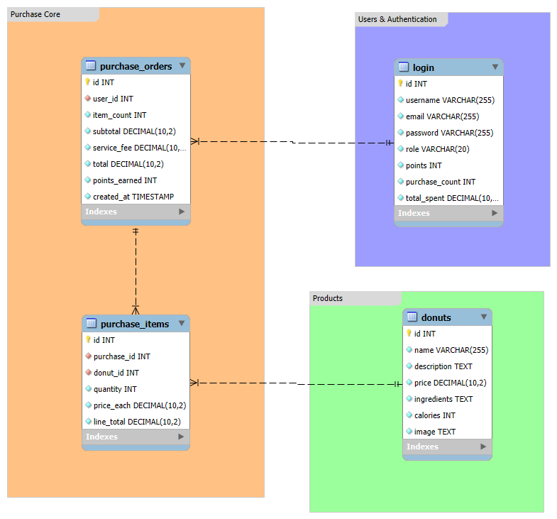

# Donuts for You — Backend

The REST API for **Donuts for You**, a donut shop application. It is built with Node.js, Express, and MySQL, and supports authentication, catalog management, checkout, rewards, purchase history, and admin tools.

## Database ERD



The SQL schema is available in [`schema.sql`](./schema.sql).

## Features

- User registration and login with bcrypt password hashing
- JWT authentication in HTTP-only cookies and role-based authorization
- Donut catalog CRUD operations
- Checkout, orders, and purchase items
- Member rewards and purchase history
- Admin user management
- Database health check endpoint
- Signup confirmation emails with Nodemailer

## Built with

Node.js (ES modules), Express, MySQL (`mysql2`), JWT, bcrypt, cookie-parser, CORS, dotenv, and Nodemailer.

See the [frontend README](https://github.com/shalevp-1/Donuts_front) for an overview of the application and its features.

## Run locally

Requirements: Node.js, npm, and a running MySQL server.

1. Install dependencies:

   ```bash
   npm install
   ```

2. Copy `.env.example` to `.env` and set the values for your local database and app. Do not commit `.env`.

3. Create the database and tables using [`schema.sql`](./schema.sql), then start the API:

   ```bash
   npm run dev
   ```

The server reads its configuration from `.env`. Set `FRONTEND_ORIGINS` to the frontend's exact origin; for local Create React App development, use `http://localhost:3000`.

## Environment variables

| Variable | Purpose |
| --- | --- |
| `MYSQL_HOST` | MySQL server hostname |
| `MYSQL_USER` | MySQL username |
| `MYSQL_PASSWORD` | MySQL password |
| `MYSQL_DATABASE` | Database name |
| `MYSQL_PORT` | MySQL server port |
| `JWT_SECRET` | Secret used to sign authentication tokens; use a random secret of at least 32 bytes |
| `FRONTEND_ORIGINS` | Allowed browser origins, comma-separated |

Production also needs the mail settings used by the signup email feature. Configure them for your mail provider in the deployment environment; keep credentials private.

## API routes

| Method | Route | Purpose |
| --- | --- | --- |
| `POST` | `/register` | Register an account |
| `POST` | `/login` | Sign in |
| `POST` | `/logout` | Sign out |
| `GET` | `/me` | Get the current user |
| `GET` | `/donuts` | List donuts |
| `GET` | `/donut/:id` | Get a donut |
| `POST` | `/donuts` | Create a donut (admin) |
| `PUT` | `/donuts/:id` | Update a donut (admin) |
| `DELETE` | `/donuts/:id` | Delete a donut (admin) |
| `POST` | `/checkout` | Place an order |
| `GET` | `/my-purchases` | View purchase history |
| `GET` | `/users` | List users (admin) |
| `PUT` | `/users/:id/role` | Update a user's role (admin) |
| `DELETE` | `/users/:id` | Delete a user (admin) |
| `GET` | `/health/db` | Check database connectivity |

## Deployment notes

The backend is hosted on Render. In production, the Netlify frontend sends `/api/*` requests through its rewrite to this API. Configure `FRONTEND_ORIGINS` with the deployed frontend origin (`https://dountstime.netlify.app`) and the required database, JWT, and mail environment variables in Render. Authentication cookies are HTTP-only and secure in production.
